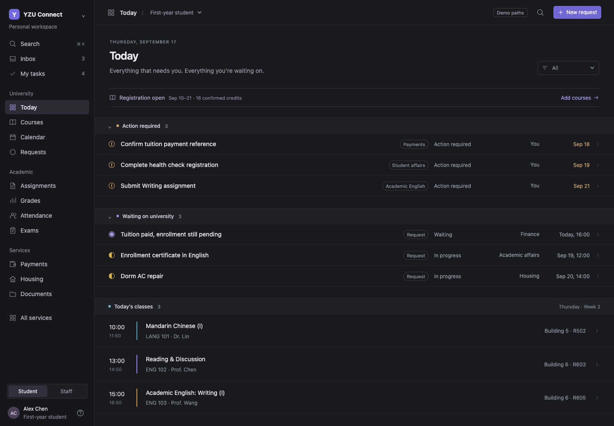
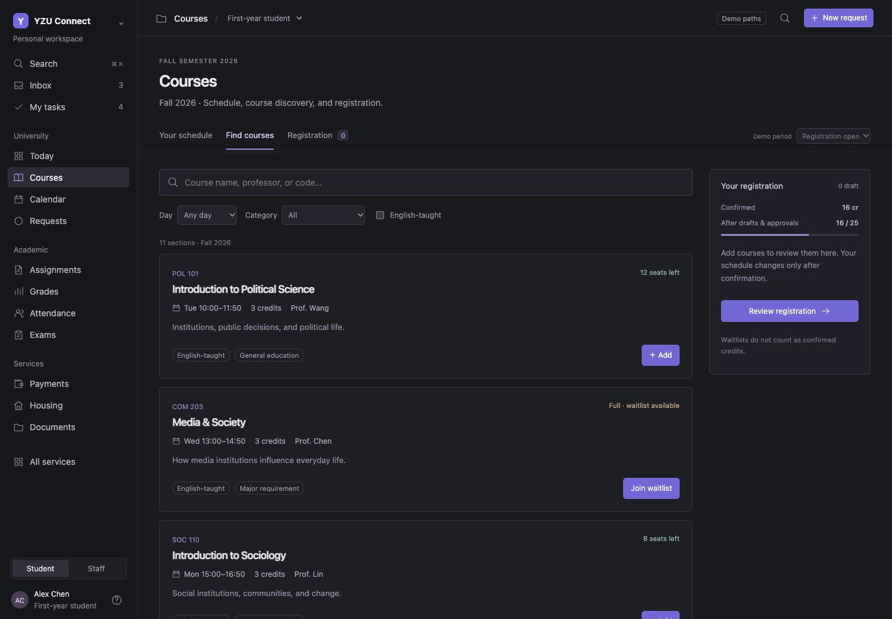

# YZU Connect — Student Portal Concept

A browser-based university workspace that brings courses, daily tasks, service requests, and case ownership into one interface.

**Status:** Interactive frontend prototype, September 2026. All people, academic records, dates, seat counts, and workflow policies are demonstration data. This is not an official Yuan Ze University system.

> Prepared for private university prototype review, authorized by Jeremy. Jeremy reports university director involvement and a professor's request to review the prototype. Permission for public redistribution has not been established.



## Project overview

University services often span several offices. This concept explores a student-facing workspace where a request has an accountable owner, accepted handoffs, and a visible next step. A staff demonstration view shows how offices could coordinate the same case.

The application runs entirely in the browser. Course registration, approvals, repair requests, and technician scheduling change in-memory sample data; they do not update university records or contact staff.

## Features

- A daily dashboard with tasks, requests, and confirmed classes, plus calendar, inbox, assignment, grade, and attendance demonstration views.
- Course discovery with search, day/category/language filters, a registration basket, and a review-and-confirm flow.
- Client-side registration checks for timetable conflicts, prerequisites, duplicate course sections, credit limits, seat availability, and waitlists.
- Separate confirmed, draft, pending-approval, and waitlisted course states.
- Student service requests with an accountable owner, case activity, specialist tasks, approval decisions, accepted handoffs, and reopening.
- A housing repair demonstration with room details and simulated technician appointments.
- A searchable service catalog with English and Chinese keyword aliases. Search uses local text matching, not a language model.
- First-year, graduating, and exchange-student demonstration profiles, plus student/staff view switching.
- Responsive styles, semantic buttons, labeled form fields, and a keyboard shortcut for search (`⌘K` / `Ctrl+K`). Accessibility has not been comprehensively audited.



## Technology stack

| Layer | Implementation |
| --- | --- |
| Structure | HTML5 |
| Presentation | CSS, responsive media queries, inline SVG icons |
| Interaction | Plain JavaScript and browser DOM APIs |
| State | JavaScript objects, arrays, and sets held in memory |
| Typography | Optional Inter font from Google Fonts, with system-font fallback |
| Build system | None required |
| Backend / database / authentication | Not implemented |

## Architecture

The proposed repository uses the editable files from the downloadable application as its root:

```text
index.html          Entry point; loads styles and scripts in order
app.js              Sample cases, service records, dialogs, and case actions
workspace.js        Workspace shell, navigation, panels, tasks, and rendering
architecture.js     Service catalog, profile context, and contextual request flows
courses.js          Course catalog, validation, registration, and approval linkage
meeting.js          Guided demo paths and housing/registration refinements
style.css           Application styles and responsive layouts
docs/images/        Authentic local screenshots
```

Scripts share global state and extend earlier functions by wrapping or replacing them. Load order in `index.html` is significant: `app.js` → `workspace.js` → `architecture.js` → `courses.js` → `meeting.js`. The final script renders the application.

This architecture makes the prototype easy to open locally. A production version would benefit from explicit modules, separated data and rendering layers, and server-side enforcement of workflow rules.

## Run locally

1. Download or clone the approved repository.
2. Open `index.html` in a current browser.
3. Select **Demo paths** to explore course registration, housing repair, or service search.
4. Reload the page to reset all changes.

No installation, account, environment variables, or build command is required. The optional Google Fonts request can be blocked; core functionality works with a system font.

For a local web address, run this from the project folder if Python is installed:

```sh
python3 -m http.server 8000 --bind 127.0.0.1
```

Then open `http://127.0.0.1:8000` in your browser.

## My contribution and AI-assisted development

I developed the idea, product direction, and design direction, drawing on what I learned from existing websites. I decided what the prototype should do and used Codex to generate and revise the implementation.

This is an AI-assisted development project. Its normal workflows run with local JavaScript rather than an AI model or AI API. Design references should be credited before any public release. The verification below was performed during portfolio preparation.

## Verification

During portfolio preparation on October 29, 2026:

- All five JavaScript files passed a syntax check.
- The dashboard and course catalog loaded in a local Chrome session with no uncaught page errors during the checked flow.
- The catalog displayed 11 sample sections. Adding an available course, reviewing, and confirming changed the demo's confirmed credits from 16 to 19.
- Reloading reset the data to the original seven lessons and six sample cases.
- The screenshots above were captured from the actual local application with the optional Google Fonts request blocked. They show fictional demonstration records.

These checks cover the stated flow; they are not a complete functional, accessibility, or security audit.

## Limitations and next steps

- Student/staff switching is a demonstration control, not authentication or authorization.
- Changes disappear on reload. There is no database, API, single sign-on, email, file upload, payment processing, or connection to university systems.
- Dates and rules are fixed sample values; they should not guide real student decisions.
- Workflows would need stakeholder review, server-side validation, secure role controls, persistence, and broader testing before real use.
- An optional browser `modelContext` integration exposes a read-only tool for fictional cases when the host supports it; it is not required for the app.

## Publication and rights

**Visibility: private prototype review.** Jeremy has authorized uploading this prototype privately for university review and reports director involvement and a professor's interest. Keep the repository private. Public sharing requires separate confirmation covering the source, university references, and screenshots.

The inspected downloadable application contains no bundled photos, videos, or commercial icon library. It uses an inline “Y” mark and university naming; those references still need review. No open-source license is assigned. Private review permission does not establish public redistribution rights.
